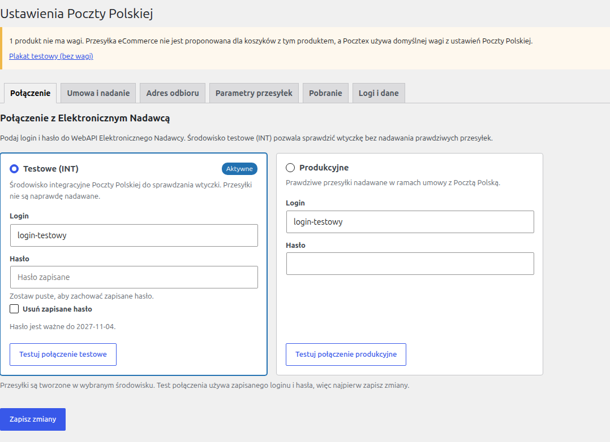

# 1. Instalacja i konfiguracja

## 1.1. Wymagania

- WordPress i WooCommerce w wersjach wspieranych przez ich twórców.
- PHP 8.2 lub nowszy z rozszerzeniem `soap`. Zalecane wersje z poprawkami bezpieczeństwa z 21.10.2026: 8.2.35, 8.3.36, 8.4.27, 8.5.12 lub nowsze. Na starszych wersjach z tej samej gałęzi wtyczka działa, ale pokazuje administratorowi ostrzeżenie.
- Rozszerzenie `sodium` (libsodium) do szyfrowania haseł; w PHP 8.2+ jest zwykle włączone.
- Konto w Elektronicznym Nadawcy z dostępem do WebAPI: login i hasło dla środowiska testowego (INT), a do pracy produkcyjnej również dla produkcji.
- Połączenie wychodzące HTTPS ze sklepu do `int-e-nadawca.api.poczta-polska.pl` i `e-nadawca.api.poczta-polska.pl` (port 443, TLS 1.2 lub nowszy).

Wtyczka działa zarówno z zamówieniem na blokach (Cart/Checkout Blocks), jak i z klasycznym zamówieniem (`[woocommerce_checkout]`), oraz z oboma sposobami przechowywania zamówień w WooCommerce (HPOS i tryb tradycyjny).

## 1.2. Instalacja

1. Zainstaluj i włącz WooCommerce.
2. Zainstaluj wtyczkę z katalogu WordPress.org (rozdział [4](04-wordpress-org-i-aktualizacje.md)) albo z pliku ZIP: **Wtyczki → Dodaj nową → Wyślij wtyczkę na serwer**, wybierz `poczta-polska-for-woocommerce-X.Y.Z.zip`, **Zainstaluj teraz**.
3. Włącz wtyczkę. W menu pojawi się pozycja **Poczta Polska** z podstronami **Ustawienia** i **Bufory**.

Przy włączeniu wtyczka tworzy trzy tabele w bazie danych i planuje zadania w tle (rozdział [3.4](03-architektura-i-api.md#34-dane)). Nie zmienia plików WordPressa ani WooCommerce.

Jeśli serwer nie spełnia wymagań, w panelu pojawia się komunikat: brak rozszerzenia SOAP blokuje połączenie z EN, a PHP bez poprawek bezpieczeństwa jest tylko ostrzeżeniem.

## 1.3. Konfiguracja wtyczki

Wszystkie ustawienia są w **Poczta Polska → Ustawienia**, w sześciu zakładkach. Każda zakładka zapisuje się osobno przyciskiem **Zapisz zmiany**. Do ustawień ma dostęp użytkownik z uprawnieniem `manage_woocommerce` (Administrator, Kierownik sklepu).

### Zakładka „Połączenie”

Dwie karty: **Testowe (INT)** i **Produkcyjne**. W każdej:

- **Login** i **Hasło** do WebAPI Elektronicznego Nadawcy. Hasło jest zapisywane zaszyfrowane i nigdy nie wraca do formularza: puste pole zostawia zapisane hasło, a pole wyboru **Usuń zapisane hasło** je kasuje.
- **Testuj połączenie** – sprawdza zapisane dane (najpierw zapisz zmiany) i pokazuje datę ważności hasła EN.
- Przełącznik **Używaj tego środowiska** – wybiera środowisko, w którym wtyczka tworzy przesyłki. Domyślnie testowe.

Zalecana kolejność: skonfiguruj i sprawdź wszystko na środowisku testowym, a dopiero potem przełącz na produkcyjne.



**Klucz szyfrowania haseł.** Hasła EN są szyfrowane kluczem wyprowadzonym z kluczy i soli WordPressa (`AUTH_KEY`, `AUTH_SALT`, `SECURE_AUTH_KEY`, `SECURE_AUTH_SALT` w `wp-config.php`). Zmiana tych soli, np. po incydencie bezpieczeństwa albo przy przenoszeniu sklepu, unieważnia zapisane hasła i trzeba je wpisać ponownie. Zalecamy więc ustawić osobny klucz **przed wpisaniem haseł**, dodając do `wp-config.php`:

```php
define( 'PPWC_ENCRYPTION_KEY', 'długi losowy ciąg, co najmniej 32 znaki' );
```

Klucz przechowuj poza repozytorium kodu i kopiuj razem z kopią zapasową sklepu. Zmiana klucza również wymaga ponownego wpisania haseł.

Wtyczka codziennie sprawdza ważność hasła EN i na 14 dni przed wygaśnięciem pokazuje ostrzeżenie w panelu. Hasło zmienia się w Elektronicznym Nadawcy, a potem wpisuje nowe w tej zakładce.

### Zakładka „Umowa i nadanie”

Ustawienia dotyczą aktywnego środowiska; dla drugiego środowiska zapisują się osobno.

| Pole | Znaczenie |
|---|---|
| Domyślna karta umowy | Karta używana przez metody dostawy, które nie mają własnej karty. Lista z EN. |
| Domyślny urząd nadania | Urząd, do którego trafiają dane przesyłek po wysłaniu bufora. Lista urzędów z umowy w EN. Dla pojedynczej przesyłki można wybrać inny. |
| Profil nadawcy | Adres nadawcy drukowany na etykietach. Profilami zarządza się w Elektronicznym Nadawcy. |
| Sposób nadania | **Kurier odbiera paczki**, **Nadaję w urzędzie nadania** albo **Nadaję w automacie Pocztex**. |
| Automat do nadawania (PNI) | Wymagany przy nadawaniu w automacie. Przycisk obok otwiera mapę Poczty Polskiej. |

Listy kart, urzędów i profili są pobierane z EN i przechowywane przez 12 godzin. Link **Odśwież listy** pobiera je od nowa.

### Zakładka „Adres odbioru”

Adres, spod którego kurier odbiera paczki po zamówieniu kuriera (rozdział [2.6](02-instrukcja-sprzedawcy.md#26-zamówienie-kuriera)): nazwa, ulica, numer domu i lokalu, kod pocztowy, miejscowość, telefony i e-mail. Puste pola są uzupełniane adresem sklepu z **WooCommerce → Ustawienia → Ogólne**. Na ten e-mail EN wysyła potwierdzenie zamówienia kuriera.

Adres nadawcy na etykietach pochodzi z profilu nadawcy (zakładka „Umowa i nadanie”), nie z tej zakładki.

### Zakładka „Parametry przesyłek”

Wartości domyślne dla nowych przesyłek; w każdej przesyłce można je zmienić przed wydrukiem etykiety.

| Pole | Znaczenie |
|---|---|
| Format (Pocztex) | S, M, L, XL, 2XL. XL nie mieści się w automatach, 2XL tylko kurier. |
| Domyślna waga (g) | Używana, gdy produkty nie mają wagi. Pocztex zawsze wymaga wagi. |
| Ostrożnie | Usługa „ostrożnie”. Pomijana przy automatach, bo EN jej tam nie przyjmuje. |
| Zawartość | Wymagana przez Pocztex, np. „Towar”. |
| Kwota ubezpieczenia (zł) | 0 oznacza brak ubezpieczenia. |
| Opis | Drukowany na etykiecie (pierwsze 40 znaków). `{order_number}` zostaje zastąpione numerem zamówienia. |
| Gabaryt (eCommerce) | Gabaryt A albo B. |
| Kategoria (eCommerce) | Ekonomiczna albo priorytetowa. |

### Zakładka „Pobranie”

| Pole | Znaczenie |
|---|---|
| Numer rachunku bankowego | Rachunek (26 cyfr) na pobrane kwoty. Wtyczka sprawdza sumę kontrolną. |
| Sposób wypłaty | Przelew na rachunek albo przekaz pocztowy. |
| Tytuł przelewu | Do 55 znaków; `{order_number}` zostaje zastąpione numerem zamówienia. |

Bramka płatności **Płatność przy odbiorze** (`cod`) musi być włączona w **WooCommerce → Ustawienia → Płatności**.

### Zakładka „Logi i dane”

- **Poziom logowania**: tylko błędy, błędy i operacje, albo wszystko (diagnostyka). Szczegóły w rozdziale [5](05-logi-i-bledy.md).
- **Usuń wszystkie dane przy odinstalowaniu** – opis w rozdziale [4.4](04-wordpress-org-i-aktualizacje.md#44-odinstalowanie).
- Stan kopii punktów odbioru z przyciskiem **Odśwież teraz**, link do logów i rejestr ostatnich operacji administracyjnych.

## 1.4. Metody dostawy

Metody dodaje się w **WooCommerce → Ustawienia → Wysyłka**, w strefie wysyłki obejmującej Polskę: **Dodaj metodę wysyłki** i wybór jednej z metod:

| Metoda | Co dostaje klient |
|---|---|
| Pocztex Kurier | dostawa pod drzwi |
| Pocztex PUNKT | odbiór w placówce Poczty Polskiej albo u partnera (np. Żabka), wybór na mapie |
| Pocztex AUTOMAT | odbiór z automatu paczkowego, wybór na mapie |
| Przesyłka eCommerce | list polecony firmowy do 2000 g |

Każdą metodę można dodać kilka razy, np. dwa warianty kuriera z różnymi cenami. Ustawienia metody:

| Pole | Znaczenie |
|---|---|
| Tytuł | Nazwa widoczna dla klienta. |
| Cena | Koszt dostawy. |
| Status podatku | Czy doliczać podatek do kosztu dostawy. |
| Darmowa dostawa od | Wartość zamówienia po rabatach, od której metoda jest darmowa. Puste: zawsze płatna. |
| Maksymalna waga (kg) | Cięższe zamówienia nie widzą tej metody. Puste: limit usługi (20 kg dla Pocztexu, 2 kg dla eCommerce). |
| Karta umowy (produkcja), Karta umowy (test) | Karta dla tej metody, np. inna dla Pocztexu i inna dla listów. Puste: karta domyślna. |
| Format paczki | Format dla tej metody. Puste: format domyślny z ustawień. |

Zasady działania metod:

- Metody Poczty Polskiej są oferowane tylko dla adresów w Polsce, także gdy strefa obejmuje inne kraje.
- Przesyłka eCommerce nie pojawia się, gdy koszyk waży ponad 2000 g albo któryś produkt nie ma wagi. Wtyczka ostrzega w panelu o produktach bez wagi.
- Płatność przy odbiorze jest ukryta dla przesyłki eCommerce.

## 1.5. Punkty odbioru

Wtyczka przechowuje kopię punktów odbioru z EN (ok. 21 tys. punktów) i odświeża ją codziennie około 5:00. Pierwsze pobranie zaczyna się przy pierwszym wejściu do panelu po włączeniu wtyczki i wymaga zapisanych danych logowania do EN. Jeśli dane wpisano później, po konfiguracji kliknij **Odśwież teraz** w zakładce „Logi i dane”. Kopia służy do sprawdzania punktów i limitów pobrania po stronie serwera oraz jako zapasowa wyszukiwarka, gdy mapa Poczty Polskiej jest niedostępna.

Zadania w tle korzystają z Action Scheduler (część WooCommerce). Na stronach z małym ruchem warto uruchamiać WP-Cron z harmonogramu systemu, żeby zadania wykonywały się o czasie.

## 1.6. Sprawdzenie konfiguracji

1. Zakładka „Połączenie”: **Testuj połączenie** dla środowiska testowego zwraca datę ważności hasła.
2. Zakładka „Umowa i nadanie”: listy kart, urzędów i profili są wypełnione, wartości wybrane.
3. Zakładka „Logi i dane”: kopia punktów ma kilkadziesiąt tysięcy punktów.
4. Zamówienie testowe w sklepie z metodą Pocztex PUNKT: mapa się otwiera, punkt zapisuje się w zamówieniu.
5. W zamówieniu: **Utwórz przesyłkę w Elektronicznym Nadawcy**, pobierz etykietę (rozdział [2](02-instrukcja-sprzedawcy.md)).
