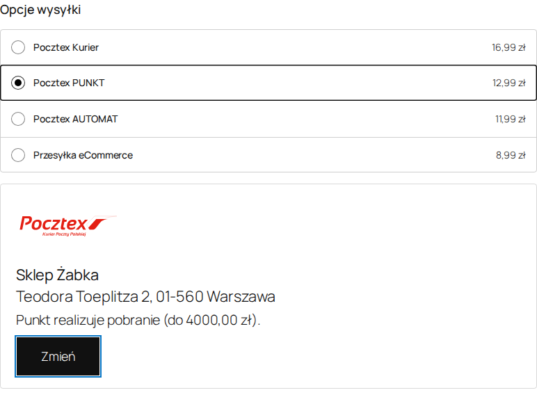
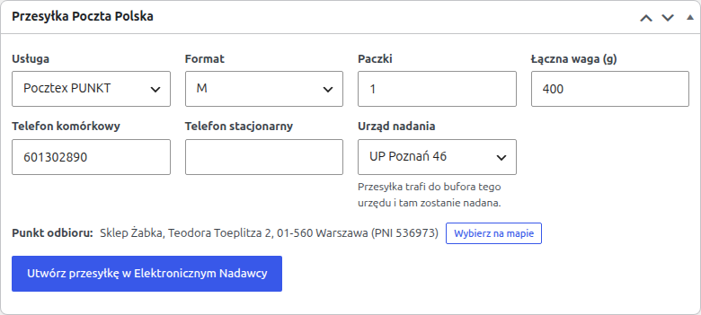
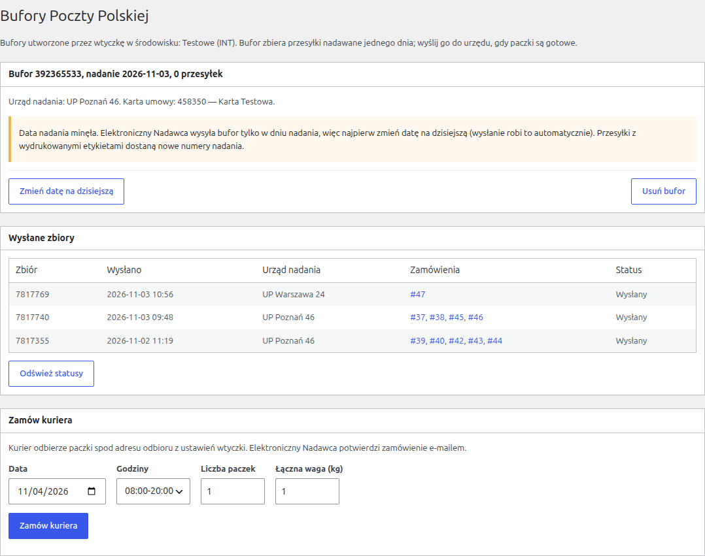

# 2. Instrukcja dla sprzedawcy

Rozdział opisuje codzienną pracę: co widzi klient w sklepie, jak utworzyć przesyłkę, wydrukować etykietę, wysłać bufor i zamówić kuriera.

Przesyłki może tworzyć użytkownik, który edytuje zamówienia (uprawnienie `edit_shop_orders`, np. Kierownik sklepu). Ekran **Bufory** i ustawienia wymagają uprawnienia `manage_woocommerce`.

## 2.1. Co widzi klient

**Metody dostawy.** W zamówieniu klient widzi metody Poczty Polskiej skonfigurowane w strefie wysyłki (rozdział [1.4](01-instalacja-i-konfiguracja.md#14-metody-dostawy)), z ich cenami.

**Wybór punktu.** Po wybraniu Pocztex PUNKT albo Pocztex AUTOMAT pojawia się przycisk **Wybierz punkt odbioru** albo **Wybierz automat**. Otwiera on oficjalną mapę Poczty Polskiej, ustawioną na adres dostawy:

- mapa pokazuje tylko punkty pasujące do metody: placówki i punkty partnerskie albo automaty,
- przy płatności przy odbiorze mapa pokazuje tylko punkty, które przyjmują pobranie, i do kwoty zamówienia,
- po wyborze pod metodą widać nazwę, adres i informację o pobraniu w tym punkcie,
- gdy mapa Poczty Polskiej nie odpowiada, wtyczka otwiera zapasową wyszukiwarkę punktów (kod pocztowy, miejscowość albo ulica).

**Sprawdzenie po stronie serwera.** Zamówienia nie da się złożyć, gdy:

- przy metodzie PUNKT albo AUTOMAT nie wybrano punktu,
- wybrany punkt jest innego typu niż metoda (np. automat przy metodzie PUNKT) albo nie wydaje paczek,
- klient płaci przy odbiorze, a punkt nie przyjmuje pobrania albo kwota zamówienia przekracza jego limit,
- klient płaci przy odbiorze za przesyłkę eCommerce.

Klient widzi wtedy komunikat przy wyborze punktu albo przy przycisku zamówienia.

**Po zamówieniu.** Wybrany punkt jest widoczny na stronie podziękowania, w e-mailach do klienta i sprzedawcy oraz w **Moim koncie** klienta.

## 2.2. Punkt odbioru w zamówieniu

W edycji zamówienia, pod adresem wysyłki, jest sekcja **Punkt odbioru** (albo **Automat Pocztex**) z nazwą, adresem i numerem PNI. Przycisk **Zmień na mapie** pozwala wybrać inny punkt, np. na prośbę klienta. Zmiana zapisuje się od razu i trafia do notatek zamówienia (widocznych dla klienta) oraz do rejestru operacji.

Punkt można też zmienić w panelu przesyłki (rozdział 2.4).

## 2.3. Tworzenie przesyłki

W edycji zamówienia jest panel **Przesyłka Poczta Polska**. Pola są wypełnione na podstawie zamówienia i ustawień:

| Pole | Znaczenie |
|---|---|
| Usługa | Pocztex Kurier, PUNKT, AUTOMAT albo przesyłka eCommerce. Domyślnie usługa z zamówienia. |
| Format | S–2XL dla Pocztexu, gabaryt A albo B dla eCommerce. |
| Paczki | Liczba kartonów jednej przesyłki Pocztex (przesyłka wielopaczkowa). |
| Łączna waga (g) | Z wag produktów albo domyślna waga z ustawień; przy kilku paczkach dzielona po równo. |
| Telefon komórkowy | Wymagany przy odbiorze w punkcie i automacie (EN wysyła na niego powiadomienia). Polski numer, 9 cyfr. |
| Telefon stacjonarny | Opcjonalny, wysyłany obok komórki. |
| Urząd nadania | Urząd, do którego bufora trafi przesyłka. Domyślnie z ustawień. |
| Punkt odbioru | Tylko dla PUNKT i AUTOMAT. **Wybierz na mapie** otwiera mapę. |

Jeśli dane zamówienia nie pozwalają utworzyć przesyłki (np. brak ulicy, nieprawidłowy kod pocztowy, za długa nazwa adresata), panel pokazuje listę **Popraw przed utworzeniem przesyłki**. Adres poprawia się w edycji zamówienia WooCommerce.

Przycisk **Utwórz przesyłkę w Elektronicznym Nadawcy**:

1. wybiera bufor na dziś dla karty umowy i urzędu nadania (jeśli go nie ma, tworzy go w EN),
2. wysyła przesyłkę do EN,
3. pokazuje numer nadania i stan przesyłki.

Przy płatności przy odbiorze przesyłka dostaje pobranie na kwotę zamówienia, z rachunkiem i tytułem z ustawień.

### Stany przesyłki

| Stan | Znaczenie | Co można zrobić |
|---|---|---|
| W buforze | Przesyłka jest w EN, etykieta nie była drukowana. | zmienić, wydrukować etykietę, usunąć |
| W buforze, etykieta wydrukowana | Etykietę pobrano co najmniej raz. | wydrukować ponownie, usunąć |
| Wysłana do urzędu | Bufor został wysłany. Pod stanem widać numer zbioru i jego stan w EN. | tylko podgląd |
| Niepotwierdzona: sprawdź w Elektronicznym Nadawcy | Połączenie z EN zerwało się w trakcie tworzenia. | **Sprawdź w EN**: wtyczka sprawdza, czy przesyłka powstała, i uzupełnia numer |
| Odrzucona | EN odrzucił przesyłkę albo jej bufor zniknął z EN. Pod stanem jest powód. | usunąć, poprawić dane i utworzyć ponownie |

Wtyczka nie tworzy podwójnych przesyłek: przy zerwanym połączeniu najpierw sprawdza w EN, czy przesyłka już istnieje.

## 2.4. Zmiana i usunięcie przesyłki

Dopóki etykieta nie została wydrukowana, w panelu przesyłki można zmienić usługę, format, liczbę paczek, wagę, telefony, urząd nadania i punkt odbioru, a potem kliknąć **Zapisz zmiany**. Wtyczka usuwa wtedy przesyłkę w EN i tworzy ją od nowa: **przesyłka dostaje nowy numer nadania**. Nowy punkt odbioru zapisuje się też w zamówieniu.

Po pierwszym wydruku etykiety przesyłki nie da się zmienić (wymaganie Poczty Polskiej). Można ją tylko usunąć przyciskiem **Usuń** i utworzyć nową.

**Usuń** kasuje przesyłkę również w Elektronicznym Nadawcy. Przesyłki wysłanej do urzędu nie da się usunąć.

## 2.5. Etykiety

- Jedna przesyłka: przycisk **Etykieta** w panelu przesyłki pobiera plik PDF.
- Wiele przesyłek: na liście zamówień zaznacz zamówienia i wybierz akcję **Poczta Polska: drukuj etykiety (jeden PDF)**, albo na ekranie **Bufory** zaznacz przesyłki i kliknij **Etykiety zaznaczonych (jeden PDF)**.

Etykiety są w formacie A4 (dwie na stronie). Przesyłka wielopaczkowa ma osobną etykietę na każdy karton, oznaczoną „1/2”, „2/2” itd.

## 2.6. Zamówienie kuriera

Na ekranie **Poczta Polska → Bufory**, w sekcji **Zamów kuriera**: data odbioru (od dziś; po 14:00 domyślnie jutro), przedział godzin, liczba paczek, łączna waga (kg) i przycisk **Zamów kuriera**. Kurier przyjeżdża pod adres z zakładki „Adres odbioru”. Elektroniczny Nadawca potwierdza zamówienie e-mailem; zamówienia nie widać w panelu EN, dalsza obsługa odbywa się poza EN.

## 2.7. Bufory i wysyłanie do urzędu

Bufor to zbiór przesyłek z jednego dnia, dla jednej karty umowy i jednego urzędu nadania. Wtyczka tworzy bufory sama przy pierwszej przesyłce danego dnia. Ekran **Poczta Polska → Bufory** pokazuje bufory utworzone przez wtyczkę w aktywnym środowisku:

- nagłówek: numer bufora, data nadania, liczba przesyłek; pod nim urząd nadania i karta umowy,
- tabela przesyłek: zamówienie, adresat, usługa, numer nadania, stan.

Działania w buforze:

| Przycisk | Działanie |
|---|---|
| Etykiety zaznaczonych (jeden PDF) | pobiera etykiety zaznaczonych przesyłek |
| Przenieś zaznaczone | przenosi przesyłki do innego bufora z tą samą kartą i urzędem (np. na inny dzień); numer nadania się nie zmienia |
| Usuń zaznaczone | usuwa przesyłki, także w EN |
| Zmień datę na dzisiejszą | pojawia się przy buforze z poprzedniego dnia |
| Wyślij do urzędu | przekazuje dane przesyłek Poczcie Polskiej; po wysłaniu bufor znika z listy, a przesyłek nie da się już zmienić |
| Usuń bufor | usuwa bufor razem ze wszystkimi przesyłkami w EN |

**Data nadania.** Elektroniczny Nadawca wysyła bufor tylko z dzisiejszą datą. Bufor z wczoraj trzeba przestawić na dziś. **Wyślij do urzędu** robi to automatycznie. Przesyłki, których etykiety już wydrukowano, dostają wtedy w EN **nowe numery nadania** i trzeba wydrukować ich etykiety ponownie. Wtyczka sama uzupełnia nowe numery i pokazuje, ile przesyłek się zmieniło. W przesyłce wielopaczkowej numery dodatkowych kartonów są na nowej etykiecie, a w panelu pojawiają się po wysłaniu bufora.

**Wysłane zbiory.** Pod buforami jest tabela ostatnich wysłanych zbiorów: numer zbioru, data wysłania, urząd, zamówienia i stan w EN (Wysłany, Dostarczony, Zwalidowany, Przyjęty albo Błędny). Stan odświeża się przy wejściu na ekran co 15 minut i przyciskiem **Odśwież statusy**. Stan **Błędny** jest wyróżniony: zbiór trzeba wtedy sprawdzić w Elektronicznym Nadawcy.

**Bufory zmienione poza sklepem.** Jeśli bufor zostanie usunięty albo wysłany bezpośrednio w Elektronicznym Nadawcy, wtyczka to wykrywa (na ekranie Bufory i przed tworzeniem przesyłek), usuwa bufor ze swojej listy i oznacza jego przesyłki jako odrzucone z wyjaśnieniem. Przed utworzeniem ich ponownie sprawdź w EN, czy nie zostały już wysłane.

## 2.8. Lista zamówień

- Kolumna **Poczta Polska** pokazuje numery nadania i stan przesyłki.
- Akcje zbiorcze (zaznacz zamówienia, wybierz akcję, **Zastosuj**), do 100 zamówień naraz:
  - **Poczta Polska: utwórz przesyłki** – tworzy przesyłki z ustawieniami domyślnymi,
  - **Poczta Polska: drukuj etykiety (jeden PDF)**,
  - **Poczta Polska: usuń przesyłki**.

  Wynik (ile się udało i błędy przy konkretnych zamówieniach) pojawia się nad listą.

## 2.9. Typowy dzień pracy

1. Rano: na ekranie **Bufory** wyślij do urzędu bufory z poprzedniego dnia, jeśli zostały (wtyczka przestawi datę; wydrukuj ponownie etykiety, które dostały nowe numery).
2. Na liście zamówień zaznacz nowe zamówienia i wybierz **Poczta Polska: utwórz przesyłki**. Zamówienia z błędami popraw i utwórz przesyłki z panelu zamówienia.
3. Wybierz **Poczta Polska: drukuj etykiety (jeden PDF)**, wydrukuj i naklej etykiety.
4. Na ekranie **Bufory** kliknij **Wyślij do urzędu** przy dzisiejszych buforach.
5. Nadaj paczki: zanieś do urzędu, do automatu albo zamów kuriera, zależnie od sposobu nadania w ustawieniach.
6. Później sprawdź w **Wysłanych zbiorach**, czy żaden zbiór nie ma stanu **Błędny**.

## 2.10. Częste sytuacje

**Klient chce zmienić punkt odbioru po złożeniu zamówienia.** Przed wydrukiem etykiety: zmień punkt w panelu przesyłki i kliknij **Zapisz zmiany**. Po wydruku: usuń przesyłkę i utwórz nową z nowym punktem.

**Klient zamówił kuriera, ale woli odbiór w punkcie.** W panelu przesyłki zmień usługę na Pocztex PUNKT, wybierz punkt na mapie i zapisz (albo utwórz przesyłkę).

**Przesyłka eCommerce nie jest dostępna w sklepie.** Koszyk waży ponad 2000 g albo któryś produkt nie ma wagi.

**Brak płatności przy odbiorze w sklepie.** Klient wybrał przesyłkę eCommerce albo punkt nie przyjmuje pobrania. Płatność przy odbiorze musi być też włączona w ustawieniach płatności WooCommerce.

**Komunikat z kodem błędu EN** (np. „… (błąd EN 84049)”). Treść pochodzi z Elektronicznego Nadawcy i opisuje przyczynę. Najczęstsze przypadki opisuje rozdział [5.3](05-logi-i-bledy.md#53-najczęstsze-błędy).
